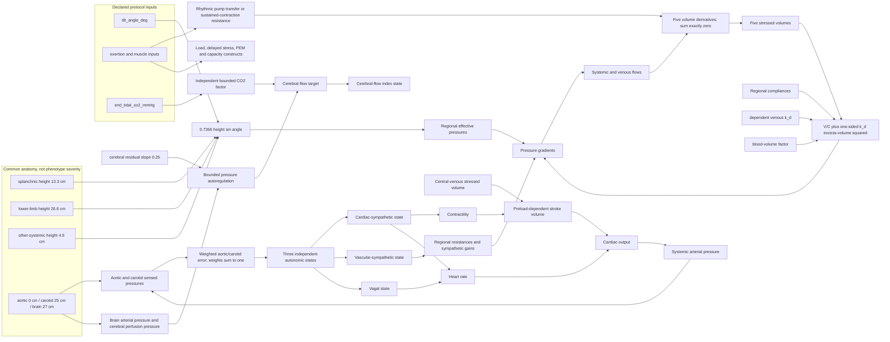

# Corrected Stage 1.3 causal dependency graph

## System graph

## Corrections relative to the Stage 1.2 interpretation

1. **Gravity acts through common anatomy.** Disease YAML files modify physiological mechanisms; they no longer assign different splanchnic or lower-limb anatomical heights. This removes the unsupported causal claim that neuropathic, mixed, or other phenotypes possess different hydrostatic columns.
2. **Dependent pressure is nonlinear above the scaled supine stressed volume.** Volume and compliance determine the linear term; excess dependent volume activates the quadratic term. The causal direction is volume/configuration → pressure → flow → volume derivative, not a direct phenotype-specific volume injection.
3. **The residual bed is a real flow path.** Other-systemic volume has its own compliance, hydrostatic pressure, arterial/venous resistances, and sympathetic resistance gain. It is not a pressure-free blood sink.
4. **Conservation is independent of elastance.** The five volume derivatives telescope exactly. Changing compliance or `k_d` changes the constitutive pressure relation and allocation, not the conservation identity.
5. **Sensor weighting is coupled.** Aortic and carotid weights are one paired degree of freedom. Their perturbations must preserve `w_a + w_c = 1`; they are not two independently identifiable weights from the present outputs.
6. **Cardiac and vascular compensation are distinct.** Cardiac sympathetic activity affects HR and contractility; vascular sympathetic activity affects regional arterial resistance; vagal activity separately affects HR. Isolated experiments quantify their different downstream effects before combination.
7. **Cerebral CO₂ is an independent declared input.** Tilt changes brain hydrostatic pressure but never infers hypocapnia. CFI does not feed back into systemic pressure in this reduced-order model.
8. **PEM remains phenomenological and separate.** Exertion/delayed-stress/capacity states are not relabeled as measured molecular, symptom, or patient-level causal processes.

## Feedback and non-additivity

The graph contains feedback: posture changes regional pressures and volumes; volumes/flows alter preload, SV, CO, and MAP; MAP changes baroreflex error; autonomic states alter HR, contractility, and resistances; those changes alter flows and volumes. Consequently, isolated parameter effects are not expected to sum to the combined response.

The fresh mechanism matrix demonstrates this non-additivity. Common geometry alone causes excessive output loss under the Stage 1.2 compensation structure, while dependent elastance alone reduces pooling and CO loss. The final result arises from their interaction with compensation changes, not from any single parameter or a linear sum of isolated effects.
